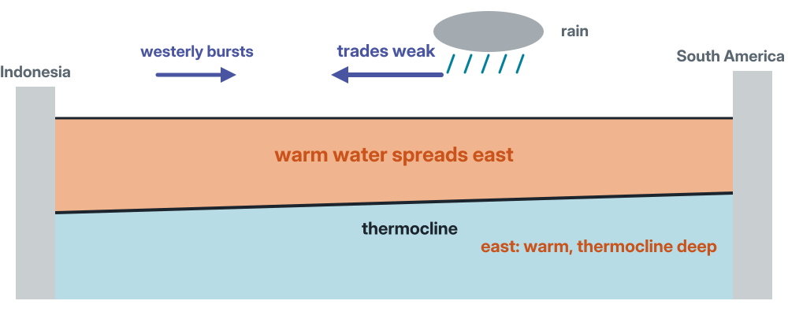
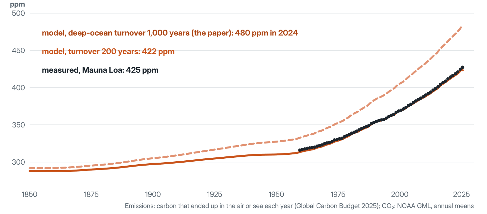
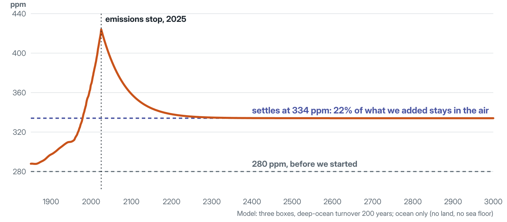

*These notes follow the lecture as it was taught. This was the last lecture of the ocean module. There is no tutorial session for it, but there is an [exercise (PDF)](../../../tutorials/carbon-boxes/exercise.pdf) with the **[Three Boxes of Carbon](../../../tutorials/carbon-boxes/)** app. Read the app's [handout (PDF)](../../../tutorials/carbon-boxes/handout.pdf): understanding the model is part of the course, and it may come up in the exam. The parts of the plan we didn't reach are at the end, under "Read this part". The readings are extracts in the course's shared readings folder, under O7.*

## The question

Until now the ocean has mostly been on the receiving end. Sunlight heats it (O2), and the wind pushes it and gives it momentum (O3–O4), and the ocean responds. Today the ocean is an active participant. How does the ocean make the climate swing from year to year? And when we add CO₂ to the air, how much does the ocean take, how fast, and where would things settle if we stopped?

## 1. Is there an El Niño right now?

Yes, a strong one. Recall the normal pattern in the tropical Pacific: the **east is cold** and the **west is warm**. In the cold east there is less evaporation and less cloud, and that is where the tropical ocean takes up the most heat (week 2). In the week of 8–14 November 2026, the pattern was turned around: the eastern Pacific was **3–5 °C warmer than usual** (+3.1 °C in the central "Niño-3.4" box, +5.4 °C off Peru).

These numbers are **anomalies**: deviations from the mean state, here the average for the same week over 1991–2020. Five degrees is not a trivial change for the ocean. Changes that size happen between the equator and the pole, driven by the difference in sunlight. To have one at the **same place**, with no change in sunlight, is huge.

For a long time scientists didn't know about this, but people in South America did, particularly in Peru. In El Niño years, rain falls on the desert coast of Peru, where it seldom rains at all: the sea is warm, and there is much more water vapour to rain out (Stewart p. 241 quotes an 1895 account). The impacts reach much further. Rainfall over the Amazon changes, and wildfires follow. Further away, the same patch of ocean affects the Indian monsoon, North America and Europe. These distant effects are called [teleconnections](https://en.wikipedia.org/wiki/Teleconnection) (Stewart §14.3). In a sense, the tropical Pacific changes the whole planet's climate **over years rather than decades**.

NOAA's [Climate Prediction Center](https://www.cpc.ncep.noaa.gov/products/analysis_monitoring/enso_advisory/) said on 12 November that this El Niño is likely to last into March 2027. How can anyone say in November what the Pacific will do in March? That is part 1.

## 2. The whole planet feels it

The figure from class is Fig. 2 of [Monteiro (2024)](https://doi.org/10.1038/s43247-024-01445-0), monthly from 1980 to 2023. The top panel is the **enthalpy** (the heat content) of the entire atmosphere, globally, not at any one place. The bottom panel is the global mean air temperature near the surface. The background shading is the strength of El Niño (red) and La Niña (blue).

The spikes line up with the strong El Niños: 1997–98, 2015–16 and 2023 (with a smaller one in 2009–10). In late 2023 the planet's monthly mean surface temperature was close to 1 °C above the figure's reference level, the highest in the record. That is a huge change for the whole planet, and it didn't come from any change in sunlight. It came from what the tropical Pacific was doing, **on top of** the warming trend: the dashed line, a running mean, climbs through the whole record. (A running mean takes a window of time, averages it, and slides the window along.) The trend is clearer in temperature than in enthalpy.

## 3. Where do slow swings come from? Two ways

The atmosphere is quick. Put energy into it and, within a week or so, whatever that energy was going to do is done. Yet we know from experience that climate changes on much longer timescales than weeks. Where does that slowness come from? Stewart: "The ocean may be the primary cause of variability over times ranging from years to decades" (p. 212). It can do this in two ways.

**1. A slow ocean adds up fast weather (O3).** Suppose the atmosphere forces the ocean with something like noise, a(t). An ocean that just responds to it does something like averaging it over a window of length τ that ends now (it can only use the past):

> O(t) ≈ (1/τ) × (the integral of a(t′) from t′ = t − τ to t)

That is a **[low-pass filter](https://en.wikipedia.org/wiki/Low-pass_filter)**: it removes the fast variations preferentially and leaves the slow ones. The ocean adds no energy here. It takes energy from the atmospheric forcing and gives back a slower, smaller version of it. Try it yourself: in Python, generate white noise, say 10,000 random numbers, and take a [moving average](https://en.wikipedia.org/wiki/Moving_average) with a window of 100 that slides along one step at a time. Plot both. The longer the window, the smaller and slower the averaged signal, because more energy has been removed. This is also what the Daisyworld-with-an-ocean tutorial shows.

**2. Ocean and air drive each other (today).** In El Niño the ocean is an active participant: it puts energy *into* the atmosphere. The atmosphere's enthalpy jumps when El Niño is strong (§2). The exchange with the atmosphere makes the swing *stronger*, not weaker, and the loop between the two can make a swing of its own.

## 4. Why the tropics, and why the east is cold

Two things make the tropics special. They receive the most energy, and they respond to it strongly, because of the [Ekman transport](https://en.wikipedia.org/wiki/Ekman_transport) from O4.

**The equator pulls cold water up.** Near the equator the trade winds blow from the east (easterlies). North of the equator, the Ekman transport is to the right of the wind, which is northward. South of the equator, the Coriolis parameter *f* changes sign, so the transport is to the left of the wind, which is southward. Water is pushed **away from the equator on both sides**, and water from below has to rise to replace it. So the warm surface layer is thin (as in the Bay of Bengal, O5), and the ocean responds strongly to any change in sunlight or in the wind. Where the warm layer is 100 m thick, a change in sunlight changes the temperature only a little: count the joules it takes to warm 100 m of water by 3–5 °C. Where it is thin, the same change does a lot.

**The books of the equatorial ocean.** In steady state, gains must equal losses. The equatorial ocean continually **loses heat** poleward, carried by water moving away from the equator, and gains it from the sun. It continually **loses mass** poleward, and gains it from below: water that sank in the subtropics flows back towards the equator beneath the surface and rises there. These loops are the ocean's **subtropical overturning**, usually called the **subtropical cells**: water sinks in the subtropics, flows towards the equator a few hundred metres down, rises at the equator, and returns poleward in the surface layer. We didn't cover them in detail, but they are how the average state keeps its books. For background, the abstract and introduction of [Capotondi et al. (2005)](https://staff.cgd.ucar.edu/cdeser/docs/capotondi.stcs.jclim05.pdf) describe the cells' branches in the Pacific (a research paper, not a course reading).

**Why the Pacific tilts.** This upwelling happens all along the equator, so it doesn't explain why the east is cold and the west warm. That needs one more step. Right on the equator, rotation plays no role, but the winds are still there, pushing the surface water west. Slightly off the equator, the wind's push is balanced by the Coriolis force, which gives the Ekman transport. On the equator it can't be, so it must be balanced by another force: a **pressure gradient** in the ocean itself. The trades pile water up in the west. The sea surface there stands a little higher than in the east, and the warm layer becomes much thicker in the west and thin in the east (Stewart pp. 239–240). The boundary between the warm layer and the cold water below, the [thermocline](https://en.wikipedia.org/wiki/Thermocline), tilts: deep in the west, shallow in the east.

Figure 1. The equatorial Pacific in its normal state. Our drawing, after Hartmann Fig. 8.10.
{: .caption}

In the east, the thermocline is so shallow that the upwelled water is cold: the **cold tongue**. In the west is the **warm pool**, where the ITCZ maps in O1 showed the most cloud and rain. The Pacific's trades are strong partly because the ocean is so wide: nothing interrupts them for thousands of kilometres until they reach the land and mountains of Southeast Asia, a bit as the Roaring Forties blow strongest where no land gets in their way.

## 5. How El Niño grows: the Bjerknes feedback

Now suppose something weakens the trade winds. It could be a burst of westerly wind, a wave, or just chance. The push that held the water piled up in the west disappears, but the pressure gradient it built is still there. Now nothing balances it, so the ocean must respond. The ocean responds slowly, though, much more slowly than the atmosphere: over weeks to months, the whole pattern relaxes from a tilted warm layer (deep west, shallow east) towards a much flatter one. The cold water in the east is no longer so close to the surface, and the east warms.

Figure 2. El Niño. Our drawing, after Hartmann Fig. 8.10.
{: .caption}

The rain follows the warm water. It moves from the west towards the central Pacific, and rising air there draws air in from elsewhere, which disrupts the east-to-west winds even more. You can't think of El Niño purely in terms of the ocean: it is a **coupled** interaction between the ocean and the atmosphere. In the normal state, the strong trades keep the rain in the west, and the rising air over the rain, drawing air in, reinforces the trades. Together they keep the pattern locked. Once the lock is broken and the rain moves, the winds weaken further, and it is hard to get back to the original state.

Figure 3. The Bjerknes feedback: two ledgers in one loop. Our drawing.
{: .caption}

This is a **positive feedback** (O6, Stommel's boxes): a change that produces more of itself. Hartmann calls it the "Bjerknes feedback" (p. 247), after [Jacob Bjerknes](https://en.wikipedia.org/wiki/Jacob_Bjerknes). On its own, it would push the tropical Pacific into a completely different state, with the east much warmer than usual, and keep it there. But the system does go back. Why? (That was a question in class.)

## 6. Why it turns around, and why it isn't a clock

Going back is trickier. The change in the wind sends a wave along the equator in the ocean, an equatorial [Kelvin wave](https://en.wikipedia.org/wiki/Kelvin_wave), moving from west to east. It is what deepens the warm layer in the east. The wind change also sends waves west, off the equator ([Rossby waves](https://en.wikipedia.org/wiki/Rossby_wave)), which make the warm layer thinner there. Like any wave hitting a boundary, these reflect off the western side of the Pacific and come back east, and they have the opposite effect: they make the eastern warm layer thin again and cool the east. The reversal arrives about six months after the warming began (Zebiak et al. 2015, p. 20), and a whole cycle of the event takes about a year. A **fast loop that feeds itself** (Bjerknes) plus a **slow, delayed loop that undoes it** (the waves, which carry the ocean's memory) gives a swing of its own (Stewart pp. 244–247).

**Not a clock.** If this were simple harmonic motion, it would have one clearly defined frequency. It doesn't: "El Niño comes back at intervals from 2–7 years, with an average near four years" (Stewart p. 246), and the record is much noisier than a sine wave. But we now understand the physics well enough to **forecast** it, and several climate centres around the world issue El Niño forecasts. The ocean's memory is what makes this possible.

**Every ocean can do this.** As a student pointed out, the Indian Ocean has a see-saw too. Nothing about the mechanism is special to the Pacific, except that the Pacific is very big: easterly winds, a warm layer whose thickness can change, more rain in one place and less in another. In the Indian Ocean it is called the **[Indian Ocean Dipole](https://en.wikipedia.org/wiki/Indian_Ocean_Dipole)**, and in the Atlantic the **[Atlantic Niño](https://en.wikipedia.org/wiki/Atlantic_Ni%C3%B1o)**. In both, the same mechanism works in a different basin.

## 7. Even slower: the deep ocean and our carbon

El Niño involves only the upper ocean, which responds to the atmosphere almost at once. Below it is a deep ocean that gets information from the surface only slowly, over centuries (O6). The deep ocean matters most for climate change.

Of the carbon we have emitted since 1750, **only about 41% is still in the air**. The ocean has taken about 28% and the land about 25% (Global Carbon Budget 2025, 1750–2024: 752 GtC emitted, where GtC is gigatonnes of carbon). The CO₂ in the air is what traps heat, so the ocean's share is one reason the warming is less than our emissions alone would suggest. (The other is that the ocean also takes up heat, which delays the warming: O2–O3.)

Figure 4. Where our carbon went, 1750–2024. Data: Global Carbon Budget 2025.
{: .caption}

**What form does the carbon take in the sea?** Very little of it is dissolved CO₂ gas. CO₂ reacts with water to form carbonic acid, which mostly gives up its hydrogen ions straight away. Almost all the carbon ends up as **bicarbonate and carbonate ions**:

> CO₂ + H₂O ⇌ HCO₃⁻ + H⁺ ⇌ CO₃²⁻ + 2H⁺

That is why the ocean holds about 50 times as much carbon as the air (Stewart p. 212). This carbonate chemistry also acts as a **buffer**: it resists changes in pH. But the buffer has limits. The reactions release H⁺, so the more CO₂ the ocean takes, the more acidic it becomes, the more the reactions are pushed back, and the less CO₂ it can take ([Revelle factor](https://en.wikipedia.org/wiki/Revelle_factor); handout §2.2).

## 8. The smallest model: three boxes

A simple model of the slow carbon cycle needs three boxes: the air; the upper ocean, which exchanges carbon with the air quickly; and the deep ocean, which exchanges carbon only with the upper ocean. The model is "BEAM", from Glotter et al. (2014), after Bolin and Eriksson (1959).

Figure 5. The three-box model. After Glotter et al. (2014) and Bolin and Eriksson (1959); our drawing.
{: .caption}

**Where does the deep ocean meet the surface?** Work it out step by step. The deep ocean is denser than the surface ocean. So for surface water to reach the deep ocean, it must become denser: cold and salty. That happens in only a few places on the planet, mainly the North Atlantic and around Antarctica (O5–O6). That is part of why the second arrow in the figure is so slow. If the deep and surface ocean were more closely coupled, the timescales would be much shorter.

**Test it on the past.** Drive the model with the carbon that actually went into the air and sea each year, and compare it with the CO₂ measured at [Mauna Loa](https://en.wikipedia.org/wiki/Keeling_Curve) since 1959. With the paper's deep-ocean turnover time of 1,000 years, the model's ocean takes up too little, and it overshoots: 480 ppm in 2024, against 425 measured. Change that one number to 200 years, and the model follows the measurements: 313, 359 and 422 ppm in 1959, 1994 and 2024, against 316, 359 and 425 measured.

Figure 6. The model against the measurements. Emissions: the carbon that ended up in the air or sea each year (Global Carbon Budget 2025); CO₂: NOAA, Mauna Loa annual means. Model runs ours.
{: .caption}

Three boxes reproduce the CO₂ record of the past 65 years. The point isn't that the climate is simple. It's that **understanding the system deeply lets you make the right simplifications**. If you try to handle all the physics, everything plays a role and it is very complex. Understanding it well enough to say "this matters, this doesn't" is what lets three boxes do the job. (There is a catch in the 200 years, though: see "Read this part".)

## 9. If we stopped today

Run the model on, and stop all emissions at the start of 2025. CO₂ falls, but it **doesn't go back to 280 ppm**. It settles at about **334 ppm**: 22% of the carbon we have added stays in the air once the whole ocean has caught up, which takes centuries.

Figure 7. If we stopped today. The model with a 200-year deep-ocean turnover; ocean only (no land, no sea floor).
{: .caption}

Where the carbon finally settles depends only on the chemistry and the size of the ocean, not on how fast it gets there. With a 1,000-year turnover or a 200-year one, it settles at the same 334 ppm (handout §§2.3 and 3.5). Over those centuries the ocean also gives some carbon back in some places, which is why a student's question (is the ocean a sink?) has the answer "on certain timescales". Over the past century it has been a net sink.

**The more we add, the more stays.** Because the buffer weakens as the ocean takes up carbon, a bigger pulse leaves a bigger share in the air. In the model, 24% of a 1,000 GtC pulse stays once the ocean has caught up, and 42% of a 5,000 GtC pulse.

All this time, the CO₂ left in the air keeps trapping heat, century after century. About 250 years of extra CO₂ is what we are dealing with.

## 10. After the ocean

The ocean isn't the end of the story. Over a few thousand years, the more acidic water dissolves calcium carbonate on the sea floor, which restores the buffer and lets the ocean take more. Over hundreds of thousands of years, the weathering of rocks takes the rest. Archer et al. (2009) put the timescales at:

- **2 to 20 centuries:** the ocean takes up most of the carbon, and 20–35% stays in the air;
- **3,000 to 7,000 years:** carbonate on the sea floor draws the airborne share down further;
- **hundreds of thousands of years:** the weathering of rocks takes the rest.

For timescales of up to about a thousand years, then, it is the ocean that sets the carbon cycle's response time.

## 11. The ledgers, closed

The module's approach has been to choose quantities and track them through the climate system, one ledger at a time. The first four, **energy, momentum, mass and salt**, are what drive the ocean's own circulation. The fifth, **carbon**, matters for climate. And, as we said last time, none of them is separate from the others: carbon (CO₂) changes the energy budget, the energy budget changes the circulation, and the circulation moves the carbon.

## Read this part: what we didn't cover in class

The most important items come first.

### Why the 200 years is a fudge

Hartmann's 1,000 years is the right turnover time for the deep ocean (O6). So why does the model need 200? **One deep box has to stand for two very different parts of the ocean.** The upper few hundred metres below the stirred layer, the thermocline, exchanges water with the surface within decades: water is pushed down into it in the subtropical gyres (O4's Ekman pumping). The abyss below takes a thousand years. Our emissions are recent, so most of the carbon the ocean has taken so far has gone into the fast part. A 1,000-year box treats the whole deep ocean as slow and misses the fast part. A 200-year box treats it all as fast.

That buys a good fit to the past at a price in the future. After emissions stop, the 200-year ocean draws CO₂ down too quickly; larger models put the ocean's catch-up at 2 to 20 centuries (Archer et al. 2009). **A model that fits the past is not automatically right about the future.** Here we even know why. The settled level, 334 ppm, doesn't depend on the fudge (§9). The handout's Run 7 asks you to sketch the better model, with the deep box split in two.

### Memory makes forecasts possible

Week 2's ruler gave a response time τ = C/λ: heat capacity over how fast the surface loses heat. By that measure the air forgets in weeks, and weather can't be forecast beyond about two weeks. The top 50 m of sea remembers for more than a year. That is why a forecast of El Niño in November can reach into March, and why climate's memory lives in the ocean.

### The tropical ocean is the atmosphere's engine

Rain over the warm tropical sea releases its latent heat in the air. Stewart calls this heating "the primary engine driving the atmospheric circulation" (p. 235). So when El Niño moves the rain, it moves the engine, and the circulation far away changes with it: equatorial processes "dominate the interannual fluctuations in global weather patterns" (p. 235).

### Close to home

El Niño years tend to be dry in India, but not always. The Indian Ocean Dipole (§6) is one reason the link isn't fixed. Recall the slide on monsoon rainfall and food grain production from earlier in the course.

### Commitment: the same slowness, the other way round

The ocean's slowness delays warming now, because the ocean takes up heat (O3). It also keeps our carbon in the air for millennia. So warming and sea-level rise go on for centuries after emissions stop. Hartmann §13.14 works through how a slow, heat-absorbing ocean delays the response to a forcing (pp. 412–415). The memory that makes El Niño forecastable is the same memory that commits us to the warming.

## Why this matters

This was the last lecture of the ocean module. Work through the [handout (PDF)](../../../tutorials/carbon-boxes/handout.pdf) for the [Three Boxes of Carbon](../../../tutorials/carbon-boxes/) app first: its seven runs go through everything in §§8–10 and the fudge above. Then do the [exercise (PDF)](../../../tutorials/carbon-boxes/exercise.pdf), which builds on them.

## Key terms

**Anomaly:** a deviation from the mean state, here a 30-year average for the same time of year. **El Niño, La Niña:** the warm and cold phases of the tropical Pacific's swing; together with the swing in the atmosphere, **ENSO** (El Niño–Southern Oscillation). **Teleconnection:** an effect of El Niño far from the Pacific. **Enthalpy:** heat content. **Running (moving) mean:** an average over a window that slides along. **Low-pass filter:** something that removes fast variations and keeps slow ones. **Cold tongue**, **warm pool**. **Thermocline:** the boundary between the warm surface layer and the cold water below. **Subtropical cells (subtropical overturning):** shallow loops that carry water from the subtropics to the equator below the surface and back at the surface. **Coupled:** ocean and atmosphere driving each other. **Bjerknes feedback:** weaker trades → warmer east → weaker trades. **Kelvin wave, Rossby wave:** ocean waves that carry the change east along the equator and west off it. **Delayed negative feedback.** **Indian Ocean Dipole**, **Atlantic Niño**. **GtC:** gigatonnes of carbon. **Bicarbonate, carbonate:** the ions that hold most of the ocean's carbon. **Buffer:** chemistry that resists a change in pH. **Revelle factor:** how much less willing the ocean becomes to take CO₂ as it takes more. **Box model.** **Turnover time.** **Airborne fraction:** the share of added carbon still in the air. **Weathering.** **Commitment:** warming and sea-level rise that continue after emissions stop.

## Readings

All extracts are in the shared readings folder, under O7. The core readings add up to **26 pages**. Page numbers are printed pages.

**Core: covered in class (22 pages)**

- Stewart, *Introduction to Physical Oceanography* (2008), Ch. 14 "Equatorial Processes", pp. 235–241 (7 pages): start at the beginning of Chapter 14 and stop at the bottom of p. 241, partway through "A Little History". The tropical ocean as the atmosphere's engine, the equatorial upwelling and cold tongue, the tilt of the sea surface and thermocline and the pressure gradient that balances the wind (pp. 239–240), the instability (p. 236), and the 1895 account of rain on the Peruvian coast (§§1, 4, 5).
- Hartmann, *Global Physical Climatology* (2nd ed., 2016), §8.3 "El Niño, La Niña, and the Southern Oscillation", pp. 246–249 (4 pages): the normal state, the Bjerknes feedback (p. 247) and El Niño (§§4–5).
- Stewart (2008), §14.2, pp. 244–247 (4 pages): the Kelvin and Rossby waves that turn El Niño around, and "2–7 years" (p. 246) (§6).
- Glotter, Pierrehumbert, Elliott, Matteson & Moyer, "A simple carbon cycle representation for economic and policy analyses", *Climatic Change* (2014), pp. 319–325 (7 pages): the paper behind the three-box model, as promised in class (§§1–4). Read for the model and its chemistry; skip the economics. **A question to ask of it:** the paper offers the model for economic and policy analyses. In the paper's own historical run, it reaches 380 ppm "near year 1994" (their Appendix A.3, not in the extract); at Mauna Loa, 380 ppm was reached in 2006. What would you want to know before using it to plan emissions cuts?

**Core: not covered in class (4 pages)**

- Hartmann (2016), §13.14 "Time-Dependent Climate Changes", pp. 412–415 (4 pages): how a slow ocean delays warming, and why the delay means commitment. Start at the heading §13.14 on p. 412 and stop at §13.15 on p. 415. Skip the equations if you like; the figures carry the argument.

**Optional**

- Archer et al., "Atmospheric lifetime of fossil fuel carbon dioxide" (2009), the whole paper (the authors' preprint): where the carbon goes after the ocean, and how long each step takes (§10).
- Zebiak, Orlove, Muñoz et al., "Investigating El Niño–Southern Oscillation and society relationships" (2015), pp. 17–21: a short history of El Niño research, from Walker's see-saw to the delayed oscillator (p. 20) and the first forecasts.
- Sarachik & Cane, *The El Niño–Southern Oscillation Phenomenon* (2010), §7.1, pp. 237–238: two pages, no equations, on Bjerknes and what his loop left unexplained. Cane co-built the first model to forecast El Niño, so this is a participant's account.
- Katz, "Sir Gilbert Walker and a connection between El Niño and statistics" (2002): how Walker, working in India after the famines, found the Southern Oscillation in the statistics, and how it was received. Sections 1–3 can be read without the equations. A historian's account is [Adamson (2020)](https://doi.org/10.2307/j.ctv10h9g13.6) (link only).
- Zebiak & Cane, "A model El Niño–Southern Oscillation" (1987): the original model paper, for the curious. Read the abstract, the introduction and the figures; skip the equations.
- Monteiro (2024), the source of §2's figure, is [open access](https://doi.org/10.1038/s43247-024-01445-0).
- The app's [handout](../../../tutorials/carbon-boxes/handout.pdf) and [exercise](../../../tutorials/carbon-boxes/exercise.pdf) are on the course site.

## Works cited

- Archer, D., M. Eby, V. Brovkin et al. (2009), Atmospheric lifetime of fossil fuel carbon dioxide, *Annual Review of Earth and Planetary Sciences* 37, 117–134, [doi:10.1146/annurev.earth.031208.100206](https://doi.org/10.1146/annurev.earth.031208.100206).
- Bolin, B. and E. Eriksson (1959), Distribution of matter in the sea and the atmosphere, in *The Atmosphere and the Sea in Motion* (Rossby Memorial Volume). Cited as the origin of the box model, via Glotter et al.
- Friedlingstein, P. and others (2025), Global Carbon Budget 2025, historical budget 1750–2024, [doi:10.18160/gcp-2025](https://doi.org/10.18160/gcp-2025).
- Glotter, M. J., R. T. Pierrehumbert, J. W. Elliott, N. J. Matteson and E. J. Moyer (2014), A simple carbon cycle representation for economic and policy analyses, *Climatic Change* 126, 319–335, [doi:10.1007/s10584-014-1224-y](https://doi.org/10.1007/s10584-014-1224-y).
- Hartmann, D. L. (2016), *Global Physical Climatology*, 2nd ed., Elsevier.
- Monteiro, J. M. (2024), The year 2023 may afford us a peek at a warmer world, *Communications Earth & Environment* 5, 280, [doi:10.1038/s43247-024-01445-0](https://doi.org/10.1038/s43247-024-01445-0) (CC BY 4.0).
- NOAA Climate Prediction Center (2026), ENSO Diagnostic Discussion, 12 November 2026 (El Niño Advisory).
- NOAA Global Monitoring Laboratory, Mauna Loa CO₂ annual means, [gml.noaa.gov/ccgg/trends](https://gml.noaa.gov/ccgg/trends/).
- NOAA OISST v2.1, daily sea surface temperature, 8–14 November 2026 (preliminary), against 1991–2020.
- Stewart, R. H. (2008), *Introduction to Physical Oceanography*, Texas A&M University (CC BY-NC-SA).
- Zebiak, S. E., B. Orlove, Á. G. Muñoz et al. (2015), Investigating El Niño–Southern Oscillation and society relationships, *WIREs Climate Change* 6, 17–34.
- The cross-sections, the loop and the model runs in Figures 1–7: our own, from the model in the app.

## Questions to think about

1. Do the white-noise experiment of §3 in Python. How does the size of the averaged signal change as you double the window? Can you explain the answer by counting how many independent random numbers each average contains?
2. The east Pacific warmed by 5 °C off Peru. Estimate the energy that takes for a warm layer 20 m thick, and for one 100 m thick, over an area of 1,000 km by 1,000 km. Compare with the sunlight that area receives in a month.
3. Why must the wind's push on the equator be balanced by a pressure gradient, and not by the Coriolis force? Which way does the sea surface slope, and which way does the thermocline slope?
4. The Bjerknes feedback is a positive feedback. Name the positive and negative feedbacks in Stommel's two boxes (O6). Why does one system give a switch and the other an oscillation?
5. If the Pacific were half as wide, would you expect El Niño to come back more or less often? Why?
6. Of the carbon emitted since 1750, about 28% is in the ocean, though the ocean holds about 50 times the carbon in the air. Give two reasons from this lecture why the ocean's share is so small.
7. In the app, compare the "Our emissions, then stop" preset with 1,000-year and 200-year turnovers. Which one would you use to estimate CO₂ in 2050? In 2500? Why?
8. Why does the settled level not depend on how fast the ocean exchanges carbon? Explain it in two sentences, without equations.
9. A bigger pulse leaves a bigger share in the air. Explain why using the reactions in §7.
10. Five ledgers: energy, momentum, mass, salt, carbon. Pick one link between two of them that appeared in this module, and describe it in a sentence.
